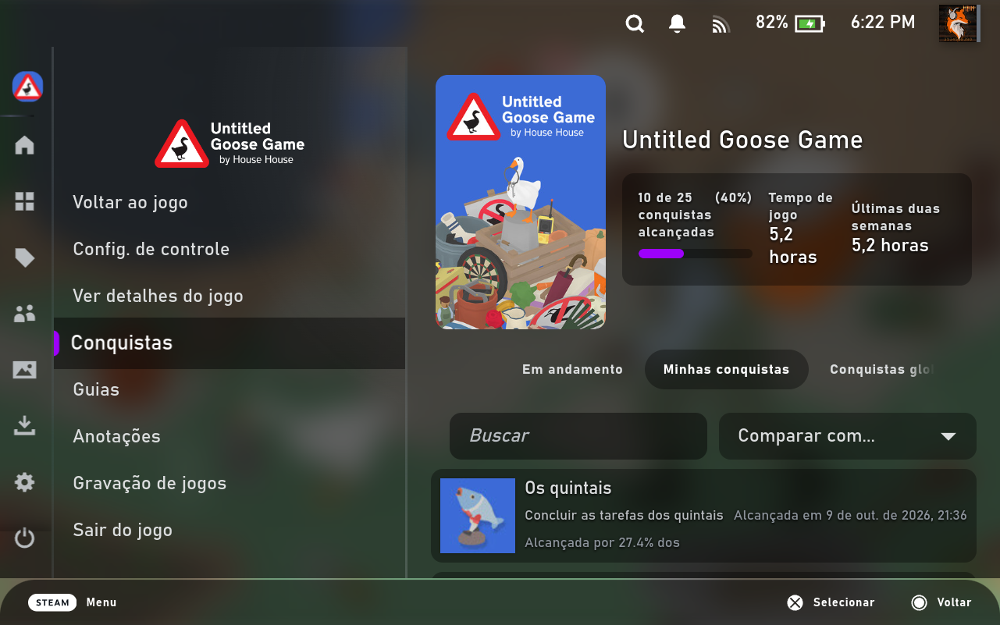
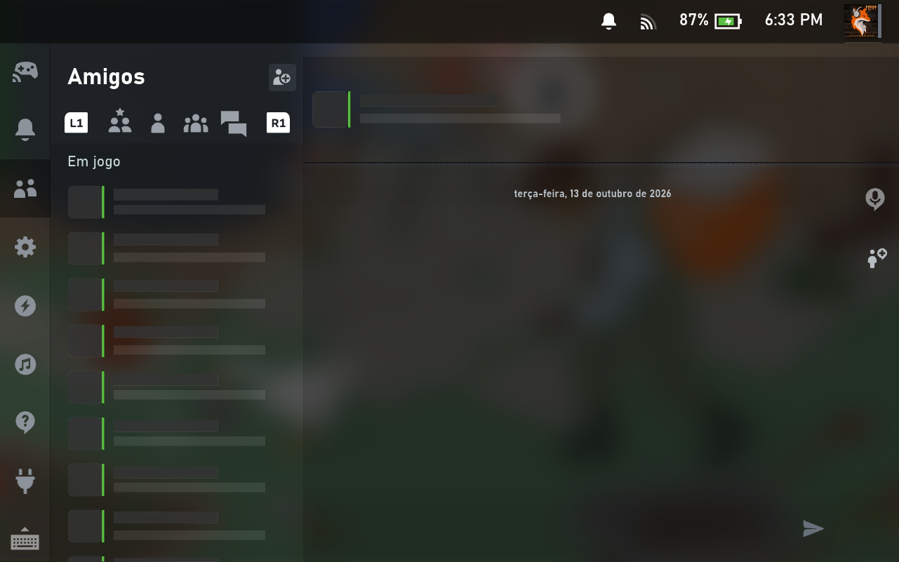

# Midnight Glass Overlay

A [Decky Loader](https://github.com/SteamDeckHomebrew/decky-loader) plugin that
**blurs the game behind the Steam menus** on the Steam Deck, and lets you tweak
the [Kitsune Midnight Glass](https://github.com/K1tsune12/decky-kitsune-midnight-glass-theme)
theme from the Quick Access Menu, with presets.


*Steam menu over a running game: translucent, with the game blurred behind it.*


*Friends and chat in Quick Access over a running game (names hidden).*

## Features

- **Game blur behind menus**: while the Steam menu, Quick Access or a dialog is
  open over a running game, the game behind it is blurred. When you go back to
  the game it is sharp again. Adjustable strength (4–64 px).
- **Theme controls in Quick Access**: change the Kitsune Midnight Glass options
  you use most while playing (menu, chat, dialog and notification opacity,
  selection, in-game overlay options, main and accent color) without opening
  CSS Loader.
- **Presets**: save the current setup (every theme option, custom colors and the
  blur settings) under a name, apply it later, overwrite or delete it.
- **Reset to defaults**: restore every theme option and the blur settings.

The blur works on its own; the theme controls and presets need the
Kitsune Midnight Glass theme installed in CSS Loader.

## Why a plugin

CSS blur can't see the game: the Steam menus are separate windows drawn on top
of it, so `backdrop-filter` there has nothing to blur and just turns black.
The blur has to come from gamescope, the Deck's compositor, which only a plugin
can turn on.

## Install

1. Download `Midnight-Glass-Overlay-vX.Y.Z.zip` from the
   [latest release](https://github.com/K1tsune12/decky-midnight-glass-overlay/releases/latest).
2. In Decky's settings, enable **Developer mode**.
3. Under **Developer**, use **Install Plugin from ZIP File** and pick the zip.

## How it works

SteamUI already has a small store that asks gamescope to blur the game for a few
of its own dialogs (`GamescopeService.SetBlurParams`, mode 1 = blur only while
Steam is drawn over the game). The plugin hooks that store so the blur stays on,
with your strength, whenever no Steam dialog needs its own. Unloading the plugin
restores Steam's behavior.

Theme options are changed through CSS Loader, so everything stays in sync with
CSS Loader's own settings. Presets and blur settings are stored locally on the
Deck.

## Build

```sh
pnpm install
pnpm build
```

## License

BSD-3-Clause
